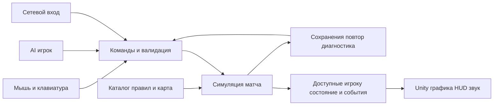

# План воссоздания StarCraft II в Unity

Дата: 20 октября 2026 года. Статус: исполнение плана начато по запросу пользователя.
Прогресс первого среза: [current iteration](current-iteration.md). Предложенные
этапы ниже описывают полную цель и не означают её завершение.

Цель — воспроизвести игровой опыт StarCraft II в этом проекте: управление армией, экономику, три асимметричные расы, бой, графику, звук и режимы. Первый законченный продукт — качественный skirmish трёх рас. Полная цель также включает сеть, кампании, кооператив и пользовательские карты; первый skirmish не закрывает этот объём.

Связанные материалы: [исследование и первичные источники](reference-research.md), [контракты и владение состоянием](../../tools/project-memory/specs/sc2-recreation-contract.md), [проверенный стек](../../tools/project-memory/specs/technology-stack.md). Текущая реализация и её проверки перечислены в [первой итерации](current-iteration.md); таблицы ниже сохраняют полный целевой объём.

## Исходное состояние и рабочие допущения

На старте исследования были подтверждены Unity 6000.3.24f1, пустой `Assets/`, отсутствие сцен в Build Settings и Built-in Render Pipeline. После начала реализации созданы runtime, тесты, Frontier.unity и Windows-сборка. Сетевой backend отсутствует.

При исследовании 20 октября CLI и прямой MCP-вызов не нашли доступного Pipeline-сервера Editor. При реализации подключение восстановлено: persistent batchmode Editor, успешные CLI и MCP-вызовы через официальный клиент; пакет не переустанавливался. Unity CLI 1.0.0-beta.13 совпал с версией из `self-update --check`. Точная процедура и ограничения GUI — в [runbook](../../tools/AGENT_RUNBOOK.md).

Рабочие допущения первого продукта: Windows x64, мышь и клавиатура, вид сверху с перспективой, локальный AI, русский UI с ресурсами локализации. Это предложения плана, а не уже заданные пользователем ограничения. Другие платформы — отдельная ветка проверки.

## Эталон и степень сходства

Предлагаемый melee baseline — **Legacy of the Void, Versus 1v1, live 5.0.17**, без PTR и сторонних модификаторов. Blizzard опубликовала 5.0.17 с частичным возвратом баланса к 5.0.15; «последний SC2» нельзя использовать как постоянно меняющуюся спецификацию. [Официальный патч](https://news.blizzard.com/en-gb/article/24309308/starcraft-ii-5-0-17-patch-notes).

До переноса чисел создать manifest эталона: game version, base build, data version, data build при доступности, зависимости, карта/hash, скорость игры и слоты. Локальный build SC2 сейчас не проверен. Campaign и Co-op требуют отдельных rulesets: их зависимости и контент отличаются от melee. [Standard Dependencies](https://s2editor-guides.readthedocs.io/New_Tutorials/01_Introduction/013_Standard_Dependencies/).

| Ось соответствия | Что проверять | Условие готовности |
| --- | --- | --- |
| Механики | Приказы, экономика, производство, бой, обзор, расовые исключения | Сценарии каждого механизма пройдены |
| Числа и время | Стоимость, HP/щиты, дальность, интервалы, скорость, footprint, prerequisites | Есть версионный источник и измерение; допуск задан для каждого поля |
| Управление | Отзывчивость, очереди, групповой ход, targeting, отмена, камера | Пройдены записанные input-сценарии и игровые проверки |
| Изображение и звук | Силуэты, масштаб, цвета, анимации, VFX, UI, audio | Закрыт asset inventory и сравнения на игровой камере |
| Режимы и контент | Карты, миссии, прогрессия, Co-op, custom games | Соответствующая ветка пройдена целиком |
| Онлайн | Lobby, матчи, observer, отказы, сервисы | Проверены реальные клиенты и эксплуатация |

Каждый элемент инвентаря проходит `не исследовано → описано → реализовано → проверено`; последний статус содержит evidence. Приблизительная модель или способность не закрывает точное соответствие. Совместимость с Battle.net, `.SC2Replay`, Galaxy и оригинальными пакетами карт — отдельные задачи совместимости, она не появляется автоматически.

## Полный объём продукта

| Направление | Содержание полной цели | Что является промежуточным результатом |
| --- | --- | --- |
| Melee | Полный baseline-каталог трёх рас: сущности, формы, способности, upgrades, tech trees, экономика, карты, AI | Одна раса и одна карта проверяют ядро |
| Управление | Выделение/подгруппы, группы, smart orders, Shift, rally, камера, minimap, hotkeys | Базовый HUD ещё не полное управление |
| Сеть | 1v1, командные режимы, custom lobby, observer, pause/leave/disconnect policy | Два локальных процесса проверяют транспорт |
| Кампании | Wings of Liberty, Heart of the Swarm, Legacy of the Void; пролог/эпилог и миссионные пакеты; Nova Covert Ops отдельно | Первая законченная миссия проверяет pipeline |
| Co-op | Инвентарь командиров и прогрессии, миссий, целей, сложностей/модификаторов | Одна миссия и два командира проверяют механизм |
| Custom и Arcade | Authoring карт/данных/триггеров/UI, зависимости, упаковка, пользовательский каталог и загрузка | Внутренний level tool не заменяет платформу |
| Онлайн-сервис | Аккаунты, приглашения, matchmaking, рейтинг, версии, мониторинг/поддержка | Direct connect не заменяет онлайн-сервис |
| Подача | Модели, анимации, окружение, VFX, звук/музыка, портреты, интерфейс, обучение/настройки | Placeholder допустим до art gate |

Для Arcade конечная цель — платформа и утверждённый инвентарь демонстрационных карт. «Все когда-либо опубликованные карты сообщества» — бесконечный внешний набор. Коллекционные скины, достижения и исторические сервисные функции учитывать отдельными строками соответствия; не скрывать их отсутствие в отчёте о разнице с оригиналом.

## Система и владельцы модулей

Предлагается чистая C#-симуляция с единым шагом времени и отдельное Unity-представление. Начать с компактного состояния и GameObject-представлений; Jobs/Burst/Entities вводить по измеренному профилю. Не размещать независимую игровую логику в `Update()` каждого юнита.



В SC2 Actors обслуживают изображение и звук отдельно от синхронизированного gameplay. Это поддерживает нашу границу: Animator, VFX и Transform не определяют здоровье, позицию или урон симуляции. [Actors](https://s2editor-guides.readthedocs.io/New_Tutorials/04_Data_Editor/060_Actors/).

| Модуль и владелец | Собственная ответственность | Публичная граница |
| --- | --- | --- |
| Core | IDs, время, PRNG, порядок систем, lifecycle матча | MatchConfig, Step, CommandEnvelope, MatchEvent |
| Content | Definitions, связи и версии | Validated immutable Catalog, content hash |
| World/Navigation | Высоты, слои, footprints, blockers, маршруты/avoidance | PlacementQuery, NavigationRequest/Result, map revision |
| Economy/Production | Ресурсы, грузы, supply, стройка, очереди/исследования | Cost transactions, production states |
| Combat/Abilities | Цели, оружие, эффекты, статусы, формы, смерть | TargetQuery, Effect execution, ability lifecycle |
| Visibility | Обзор, explored, last-known, cloak/detection; аудитория событий | PlayerObservation, PlayerEvent и queries |
| Presentation/Input | Камера, выбор, HUD, звук, анимации | Производит команды, читает observation/events |
| AI | Стратегия, экономика, разведка, micro | Те же команды и observation, что у игрока |
| Persistence/Diagnostics | Snapshot, replay, hash, воспроизведение дефекта | Versioned save/load/log |
| Multiplayer | Авторитетность, delivery, sessions, версии | Validated commands, observation deltas |
| Missions/UGC | Цели, triggers, прогрессия, сценарные пакеты | Versioned map/mission package |

Числа имеют один источник: предлагаемый authoring — JSON со схемой и стабильными ID → проверенный runtime catalog. Prefab связывает ID с изображением, HUD читает тот же каталог. ScriptableObject-обёртка допустима как инструмент редактирования, но не второй независимо редактируемый набор цен.

Время, скорость игры и точность координат фиксируются исследованием эталона. Ресурсы целые, PRNG явный/сохраняемый, обходы и разрешение конфликтов стабильные. `FixedUpdate` сам по себе не доказывает воспроизводимость. [Unity fixed updates](https://docs.unity3d.com/6000.3/Documentation/Manual/fixed-updates.html).

Основной сетевой кандидат — авторитетный сервер с отфильтрованным состоянием каждого игрока; offline использует тот же match host локально. Ранний эксперимент проверяет bandwidth/задержку и выбор транспорта. Lockstep — альтернатива при подтверждённой необходимости и детерминизме; передача полного мира клиенту не защищает его от модифицированного клиента. Два полных сетевых runtime параллельно не разрабатывать.

## Этапы и наблюдаемые результаты

Каждый этап заканчивается запускаемым результатом и evidence. Navigation, replay, network и art эксперименты идут до полного roster.

| Этап | Работы | Условие перехода |
| --- | --- | --- |
| E0 Эталон | Версии/режимы, roster, карты, rule sources, asset inventory, reference PC, папки; проверка Editor | Реестр полноты и эталонные сценарии; неизвестное помечено |
| E1 Техническое ядро | Commands/time/IDs/catalog, snapshot/log/hash; spikes пути, сети и синтетического рендера | Симуляция без графики воспроизводится; выбраны math/time/network и предварительный render подход |
| E2 Первый матч | Terran-срез: база/рабочий, минералы/газ, supply, производство, боец, активная способность, AI/HUD/исход | Меню → добыча → развитие → бой → результат → повтор; mid-match save работает |
| E3 Общие механизмы | Полные приказы, navigation/avoidance, placement, effects/combat, fog/detection, upgrades, transport/morph primitives | Контрактные сценарии сложных взаимодействий пройдены |
| E4 Полные Terran | Полный baseline-каталог, add-ons, repair, lift/land, формы, энергия/исследования | Полные build orders и сценарии расы без заглушек правил |
| E5 Zerg и Protoss | Сначала расовые механизмы, затем все сущности и способности | Три tech tree, шесть пар рас с зеркалами, перестановки стартов, корректные исходы |
| E6 Полированный skirmish | Карты, AI-профили, replay viewer, save/observer, UI/обучение/настройки, полный art/audio этапа | Самостоятельная Windows-сборка, закрытая skirmish-матрица и бюджеты |
| E7 Полная сеть | Развить E1-пилот: lobby/1v1, pause/leave/disconnect, observer, команды/союзы | Реальные клиенты проходят версии, задержку/потери, reconnect policy и visibility |
| E8 Кампании | Scenario framework, первая миссия, метапрогрессия; затем каждый campaign package | Все обязательные миссии/ветви/цели/saves/диалоги/cinematics по инвентарю |
| E9 Co-op | Командиры/progression, mission AI, волны/цели, сложности/модификаторы | Матрица миссий и сочетаний командиров, синхронизация двух игроков |
| E10 Custom/Arcade | Редактор, triggers, packaging, версии, безопасное исполнение, каталог | Пользователь создаёт/передаёт карту; другой клиент запускает совместимый пакет |
| E11 Онлайн и полный выпуск | Аккаунты/приглашения, matchmaking/рейтинг, deployment/monitoring; вся регрессия | Все заявленные режимы/workflows закрыты; разница с оригиналом перечислена |

Основная цепочка: E0 → E1 → E2 → E3 → E4 → E5 → E6. Сеть исследуется в E1 и полноценно поставляется в E7. E8 может развиваться после E3; E9 зависит от сети и mission framework; E10 — от зрелых catalog/world authoring. Сервисные контракты проектируются до E11; запуск внешних сервисов остаётся отдельной операцией.

E0 создаёт полный реестр, схему и список неизвестного; отсутствие измеренного SC2 не блокирует ядро с явно тестовыми данными. Подтверждённые значения конкретного content batch обязательны перед его переносом как эталонного и заявлением соответствия. E2 уже реализует минимальные рабочие navigation/combat/effects/fog через пакеты первой очереди; E3 расширяет эти механизмы до полного общего контракта.

E6 — законченная игра в объёме skirmish. E11 — завершение полного указанного перечня. Календарную оценку уточнить после замера E1/E2: наиболее дорогими могут стать контент, анимация и миссии, а не только программирование.

## Первая очередь задач

Полный статус пакетов не следует выводить из наличия первого среза. Каждый пакет получает writable scope, contract owner, сценарий, локальную проверку и интеграционный выход; текущие факты отмечены в current-iteration.md.

| ID | Пакет | Зависимости | Проверяемый результат |
| --- | --- | --- | --- |
| REF01 | Manifest эталона и completeness inventory | Нет | Версии/режим/карта, источники и неизвестное записаны |
| REF02 | Эталонные input/добыча/дуэли/timing scenarios | REF01 | Заданы входы и допуски до сравнения |
| SYS01 | Папки, asmdef, test assemblies, diagnostics | E0 | Runtime/Editor разделены, минимальный тест исполняется |
| CORE01 | IDs, clock, PRNG, Step | SYS01 | Две симуляции дают одинаковые hash каждого tick |
| CMD01 | Envelope, validation, duplicates, queues/errors | CORE01 | Повтор/невалидная/устаревшая команда не меняет запрещённое состояние |
| DATA01 | Unit/building/weapon/ability/upgrade/map catalog | CORE01 | Некорректные ID, ссылки и единицы выявляются до старта |
| SAVE01 | Snapshot и accepted command log | CMD01, DATA01 | Load + продолжение совпадают с непрерывным прогоном; после BOT01 также сравниваются новые команды работающего AI |
| WORLD01 | Height/movement/placement и footprints | DATA01 | Границы и карта проверяются одним источником правил |
| NAV01 | Путь и групповое движение | WORLD01, CORE01 | Рампа/встречный поток/dynamic blocker; stuck и CPU evidence |
| NET01 | Ранний host/client pilot | CMD01, SAVE01 | Два процесса, version handshake, отклонение чужих команд |
| VIS01 | Fog, last-known, detection, observation/events | WORLD01 | UI/AI/network payload и события не выдают запрещённые сведения скрытого мира |
| ECO01 | Рабочий/груз/узел/drop-off/supply | NAV01, CMD01 | Добыча, истощение, потеря базы/пути и смена приказа |
| PROD01 | Стройка, очереди, отмена/возврат | ECO01, DATA01 | Нет двойной оплаты, неправильных резервов и refund |
| FIGHT01 | Оружие, targeting, damage/death | NAV01, VIS01 | Контрольные дуэли и одновременные события согласованы |
| ABIL01 | Cast/target/effect/energy/cooldown | FIGHT01 | Валидный/невалидный cast, cancel, expire, смерть источника |
| VIEW01 | Камера/выбор/команды/HUD/minimap | CMD01, VIS01 | Проверки через input/UI, а не только прямой Step |
| BOT01 | Build order, разведка и нападение | PROD01, FIGHT01 | Матч завершается без скрытого знания; сохраняется command log |
| ART01 | Production-art slice | VIEW01, FIGHT01 | База/рабочий/боец читаемы; состояния/анимация согласованы |
| SLICE01 | Полный E2 workflow | SAVE01, ECO01, PROD01, ABIL01, VIEW01, BOT01 | Законченный матч и replay без ручного исправления состояния |
| PERF01 | Baseline/stress profile | NAV01, FIGHT01, ART01 | Железо, настройки, tick/frame CPU/GPU/memory измерены |

Следующие эпики `RACE-T/Z/P`, `CAMP-WOL/HOTS/LOTV/NOVA`, `COOP`, `UGC` декомпозируются из полного инвентаря тем же способом. Задача ссылается на контракт, content rows и evidence; название задачи не заменяет спецификацию.

## Проверка механик

SC2 Data Editor разделяет Units, Abilities, Effects, Behaviors, Requirements, Validators, Weapons, Footprints и Upgrades. Для нас это основание сначала проверять общие исполнители, затем наполнять каталог. [Data Editor Introduction](https://s2editor-guides.readthedocs.io/New_Tutorials/04_Data_Editor/058_Data_Editor_Introduction/).

| Подсистема | Обязательные сценарии |
| --- | --- |
| Приказы | Выбор/подгруппы, smart order, Move, Attack-Move, Stop/Hold/Patrol, Shift, rally; исчезнувшая цель/непроходимая точка |
| Добыча | Дойти → добыть → нести → сдать → повторить; saturation, истощение, потеря drop-off, переназначение |
| Производство | Prerequisites/ресурсы/supply → резерв/оплата → исполнение → завершение/отмена; стадия возврата берётся из эталона |
| Карта | Placement → строительство → dynamic blocker → lift/destroy → новый путь; preview и execution совпадают |
| Бой | Acquisition/approach/turn → attack → launch/impact → damage/death; ground/air, armor/shields, splash/healing |
| Способности | Target/cost → cast/channel → effect → cooldown/expire; stacks, filters, cancel, смерть источника |
| Информация | Unknown/visible/explored, last-known; высоты, cloak/burrow, detection отдельно |
| Terran | SCV build/repair, add-on attach/detach, Reactor/Tech Lab, lift/land, transform, orbital-механики |
| Zerg | Larva/egg/unit, Drone/building, morph, creep/inject, burrow, доступные формы обороны |
| Protoss | Probe warp-build, power/loss, Gateway/Warpgate, warp-in, Chrono, shields и формы/слияния |

Расовые исключения и числа полностью инвентаризируются по pinned baseline. Исторические tutorials помогают понять процесс, но не устанавливают актуальный баланс. [Terran add-ons](https://news.blizzard.com/en-us/article/5740265/game-guide-terran-add-ons), [raw protocol](https://github.com/Blizzard/s2client-proto/blob/master/s2clientprotocol/raw.proto).

## Ранние технические эксперименты

Следующие числа — предлагаемые бюджеты нашего проекта, не характеристики SC2 и не измеренные результаты. E0 закрепляет ПК, карту, разрешение и нагрузку.

1. **Повторяемость.** Две симуляции выполняют один журнал 30 минут игрового времени; hash сравнивается каждый tick, затем отдельно Editor/standalone. Выбрать math/time/PRNG. Частоту согласовать с измеренными таймингами SC2; произвольные 20/30 Hz — только кандидаты эксперимента.
2. **Массовое движение.** 200/400/800 сущностей, разные радиусы, рампы, встречные потоки, здание на пути. Измерить arrival/stuck/unreachable/CPU. Выбрать grid/NavMesh/hybrid, local avoidance; shared paths/flow fields применять по измеренной пользе. Постоянный жёсткий строй не навязывать всем приказам.
3. **Fog.** Сравнить observation со сценой; проверить tooltip/minimap/audio/AI, network payload/event stream и причины отказа команд на утечку запрещённых ID/координат. Проверить переходы видимости, last-known, высоты и detection. Полный authoritative log отделён от разрешённых игроку событий.
4. **Save/replay.** Снимок на границе tick во время добычи, стройки, эффекта и полёта projectile; после load тот же дальнейший hash. После BOT01 сравнить непрерывный прогон с save/load при заново работающем AI: новые команды и hash должны совпасть. В E8 добавить mission/trigger/progression states. Несовместимые версии отклоняются.
5. **Сеть.** Два процесса, моделируемые 50/150/250 ms RTT, jitter, 0/1/5 процентов loss, duplicate/out-of-order. Ownership, version handshake, resync либо корректный явный отказ. Финальный gate включает разные машины.
6. **Performance.** Базовый случай 400 активных сущностей, stress 800; это объекты, не supply. Предварительный ориентир — 60 FPS при 1920×1080 на reference PC, frame p95 ≤ 16,7 ms, tick p95 ≤ 8 ms. Memory/bandwidth/GC budgets закрепляются после E1; устойчивые allocations ядра устраняются. Измерять standalone. [Unity Profiler](https://docs.unity3d.com/6000.3/Documentation/Manual/profiler-introduction.html).
7. **Art/pipeline.** В E1 — отдельный render-only стенд синтетических объектов, без зависимости от ещё не готовых combat/fog/HUD; он даёт предварительный выбор pipeline. В E2 ART01 собирает базу/рабочего/бойца/ресурс, стрельбу/смерть/fog/HUD и закрывает окончательный visual/perf gate до массовых моделей. Built-in — исходная точка; переход на URP не является уже разрешённой заменой зависимостей.

## Графика и звук

Asset inventory: роль/силуэт → mesh/UV/material → rig/clips → sockets → LOD/collider → VFX/audio/icon → prefab → проверка на игровой камере и в бою. Все применимые состояния обязательны: idle/move/attack/cast/death, build/morph/deploy/burrow/fly. Исход атаки вычисляется симуляцией, анимация его отображает.

Blender полезен для mesh, UV, rigging и сложных clips; его установка не проверена. Terrain, технические формы, материалы, частицы, UI и маркеры можно начинать в Unity. Генерация 2D concepts/текстур/иконок не заменяет готовые rigged 3D-модели.

Для точного внешнего сходства потребуется полный отдельный набор моделей, текстур, анимаций, портретов, audio/music и cinematics с записанным происхождением ресурсов. Собственная приближённая модель остаётся отмеченной как приближение. Сложная органика, лицевая анимация и кинематографическая озвучка — отдельное производство, не автоматическое следствие готового кода.

Art gate: юнит различим по силуэту; владелец/selection читаются; VFX не скрывают угрозы и не выдают невидимого врага; mesh согласован с footprint; события анимации совпадают с gameplay; references и render/audio budgets корректны.

## Тестирование и Definition of Done

Контрактные тесты симуляции, PlayMode/input/visual проверки и standalone дополняют друг друга. Прямой вызов боя не проверяет targeting мышью и HUD.

| Проверка | Обязательный результат |
| --- | --- |
| Contract/regression | Commands, IDs, cost/refund, queues, effect/death, fog/tech и расовые сценарии |
| Интеграция | Полный workflow меню → матч → исход; content/AI/save/replay/network совместимы |
| Дифференциальная | Для одинакового сценария измерены добыча, строительство, ход, дуэль, cast/expire; допуски заданы заранее |
| AI exploration | Несколько политик и seed, зеркала, перестановки сторон, карты/позиции |
| Visual/input | Game View с HUD/fog/minimap и действия через пользовательский input |
| Нагрузка | Tick/frame p50/p95/p99, CPU/GPU, GC/memory, stuck, serialization, bandwidth |
| Release smoke | Чистый player start → настройки → матч/миссия → save/load → исход → меню → повторный запуск |

Начальная nightly-матрица: 120 матчей = 6 неупорядоченных пар рас с зеркальными × 2 перестановки сторон × 2 карты × 5 seed. Для E6: 600 матчей с 25 seed. Политики AI чередуют экономику, раннюю атаку и технологическое развитие; это не исчерпывающий перебор их сочетаний. Дополнительно нужны сценарии наиболее рискованных комбинаций способностей. Равный winrate одного бота не доказывает человеческий баланс.

Failed run сохраняет build/revision, rules/map hash, config, seed, bot versions, фактически принятые команды, первый нарушенный invariant/tick и минимальное воспроизведение. Недетерминированный AI воспроизводится журналом команд. Blizzard описывает зависимость replay от версии binary/data и предупреждает об отличиях API actions от replay actions; наш формат проверяется независимо. [SC2 protocol](https://github.com/Blizzard/s2client-proto/blob/master/docs/protocol.md).

Прогон имеет тестовый watchdog по времени/прогрессу, чтобы дефект AI или навигации не создавал бесконечный матч в автоматизации. Срабатывание watchdog — failed test с evidence, а не придуманная победа/ничья. Условия реального исхода, сдачи, раскрытия базы и ничьей фиксируются по правилам соответствующего режима в E0.

Этап готов при закрытом inventory, отсутствии известных P0/P1, пройденных workflows и обязательных бюджетах. P0 — падение/порча данных; P1 — блок обязательного workflow, воспроизводимый desync, существенная ошибка правила. Остальные дефекты перечислены. Полная цель требует всех E0–E11 и их обязательных сценариев, включая сетевой E7. Удовольствие, эстетика и ощущение управления оцениваются игровыми итерациями; абсолютное совершенство не является измеримым критерием.

## Автономный цикл и агенты

До трёх вспомогательных агентов плюс главный интегратор. Роли меняются по этапу; число агентов не заменяет ясные контракты.

| Роль | Область и граница |
| --- | --- |
| Главный интегратор | Очередь, общие контракты, интеграция; единственный координатор Editor/сцен/packages и final acceptance |
| Разработчик A | Один механизм симуляции/данных, именованный writable scope |
| Разработчик B или art specialist | Независимый механизм/UI/asset batch, без конкурирующих правок общих schemas |
| Независимый QA/reviewer | Black-box, источники, regressions, visual/perf; не принимает только отчёт автора |

Цикл: bounded task → контракт/сценарий → реализация → локальные проверки → независимый review → интеграция → end-to-end/visual/perf → минимальный дефект → исправление у владельца причины → регрессия → обновление inventory/памяти → следующий пакет. Acceptance test не ослаблять ради зелёного статуса.

До параллельной реализации согласовать поля, ownership, ошибки и порядок событий общей границы. У package manifests, shared schemas и сцен один редактор. Другие агенты работают в выделенных файлах; прогоны не конкурируют за тот же Editor. При лимите/блокере сохраняется точный checkpoint; бесконечное выполнение после остановки задачи не предполагается.

## Рабочие папки и хранение

Предлагаемая структура реализации; сейчас создаётся только документация:

```text
Assets/Game/Runtime/{Core,Content,World,Gameplay,AI,Presentation,Networking,Persistence,Missions}
Assets/Game/Editor/
Assets/Game/Tests/{EditMode,PlayMode,Fixtures}
Assets/Game/Content/{Definitions,Maps,Localization}
Assets/Game/Art/{Models,Materials,Animations,VFX,UI,Audio}
Assets/Game/Scenes/
docs/sc2/
tools/project-memory/specs/
tools/                         reusable developer tooling only
Builds/{Players,Evidence,Scratch}/
```

`Builds/` уже игнорируется Git: туда идут players, screenshots, большие логи и одноразовые probes. Definitions, тестовые сценарии и компактные manifests версионируются. Медиа и крупные payload не коммитятся без точного разрешения проекта; для production-art выбрать отдельное хранилище с manifests/checksums/retrieval instructions. Память хранит контракты и ссылки, а не сырые прогоны и ассеты.

## Риски и следующий пакет

Критический путь — проверка правил/движения и ранняя сетевая модель, затем объём контента/анимации/миссий. Публичные API и guides не раскрывают все алгоритмы. Без доступного эталона можно развивать ядро, но нельзя закрывать числовое соответствие догадками. Доступ к установленной SC2 и её конкретным локальным папкам ещё не установлен; план ничего там не устанавливает и не меняет.

Первый пакет реализации: **E0 и CORE01/CMD01/DATA01/SAVE01 плюс NAV01/NET01 эксперименты E1**, после проверки Editor. Выход — воспроизводимый RTS-стенд для сравнения управления/маршрутов и автоматического поиска дефектов, затем полный E2-матч. Изготовление всех армий до этой проверки закрепило бы контент на непроверенных механизмах.
